# VILLA · 新中式三层别墅 V10.0

纯前端单文件 Three.js 场景：新中式三层别墅 / 圆角几何 / PBR 材质 / HDR 环境反射 / 指数雾 / 空腔墙体与门窗洞 / 分层剖切 / 结构透视（X-ray） / 极简室内家具 / CSS2D 空间标签 / 昼夜光照 / 外围森林 / 风吹草叶 / 河流木桥 / 水面涟漪 / 星空闪烁与萤火虫微光 / 可进门上楼的室内漫游。

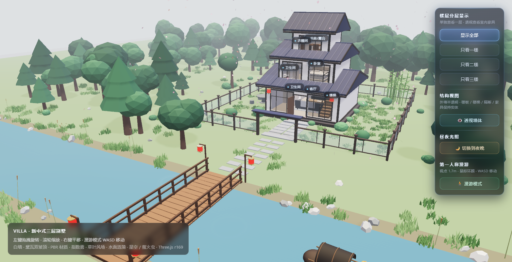

## 运行

在项目目录启动一个静态服务器（不要直接双击 HTML，浏览器对 ES Module 有限制）：

```bash
python -m http.server 8000
```

然后打开 <http://localhost:8000/villa.html>。

Three.js r169、CSS2DRenderer 与后期处理 addons 通过 jsDelivr CDN 加载，首次打开需要联网。HDR 环境贴图（`royal_esplanade_1k.hdr`）同样走 jsDelivr；如果网络不可用，页面会自动回退到程序化 Canvas 渐变环境，不会黑屏或中断渲染。

## 功能特性

- **新中式三层别墅**：7.2 / 5.4 / 3.6m 逐层退台，黛瓦坡屋顶、白墙、木格栅围栏与入户门头
- **空腔墙体与真实洞**：门洞、窗洞真正挖空，窗玻璃、窗套、竖梃与墙板分开建模
- **分层剖切**：显示全部 / 只看一楼 / 只看二楼 / 只看三楼，单层查看时整顶淡出，不再挡室内
- **结构透视（X-ray）**：外墙与玻璃透明化，隔断、楼板、楼梯、家具与屋顶保持实体，形成娃娃屋视图
- **第一人称漫游**：PointerLock + WASD，可从院门石径走进客厅、沿楼梯上二楼、过木桥到对岸
- **昼夜系统**：光照、雾、曝光、星空、萤火虫、暖窗自发光随 `nightMix` 平滑插值
- **PBR + IBL**：HDR 环境反射、ACES 色调映射、软阴影，夜间配克制的 UnrealBloom 泛光
- **程序化环境**：实例化草地（4800 簇）、200 棵外围森林、水面涟漪、飘落花瓣、萤火虫点光
- **零构建**：单文件 HTML，无 npm、无打包步骤，Three.js 由 importmap 从 CDN 加载

## 技术栈

| 类别 | 使用 |
| --- | --- |
| 渲染 | Three.js r169（ES Module + importmap，jsDelivr CDN） |
| 相机 / 交互 | `OrbitControls`、`PointerLockControls` |
| 后期处理 | `EffectComposer` + `RenderPass` + `UnrealBloomPass` + `OutputPass` |
| 环境光 | `RGBELoader` + `PMREMGenerator`（IBL）、ACES Filmic 色调映射 |
| 空间标签 | `CSS2DRenderer` |
| 性能 | `InstancedMesh`、几何体缓存，草地 / 森林 / 桥梁各压到 1 个 draw call |
| 纹理 | 全部由 Canvas 2D 程序化生成，不额外请求图片资源 |

### 环境要求

- 支持 WebGL 2 的现代浏览器（Chrome / Edge / Firefox / Safari 新版）
- 首次打开需要联网（Three.js 与 HDR 走 CDN）；HDR 拉取失败会自动回退到程序化环境，不会黑屏
- 「验证」章节的脚本需要 Node.js 20.11+（出图目录用 `import.meta.dirname` 定位），并会在本机拉起 Edge 无头浏览器；Edge 路径在脚本内硬编码，换机器需自行修改

## V10.0 更新 · 空腔墙体 / 结构透视 / 可行走室内

- 空腔外墙：每层外墙拆成独立墙板（`addOuterWall`），围着 7.2 / 5.4 / 3.6m 见方的空腔，门洞与窗洞是真正挖空的；窗玻璃、窗套、竖梃与墙板分开建模，剖切与透视只处理墙板
- 入户门：门套 + 半开门扇（`pivot.rotation.y = -Math.PI * 0.55`），门洞净宽 1.2m，第一人称可以直接从石径走进客厅
- 结构透视（X-ray）：右侧面板新增“👁️ 透视墙体”，只把外墙板与玻璃的 `transparent / opacity 0.18 / depthWrite` 打开，隔断、楼板、楼梯、家具与屋顶保持实体，形成“娃娃屋”视图；`aria-pressed` 与按钮文案（透视墙体 / 恢复实体墙）同步
- 剖切更彻底：`markRoofPart()` 给所有屋面构件（瓦面、山墙封板、正脊、檐口、博风板）打 `isRoofPanel` 标记，单层查看时整顶淡到 0.05，不再有屋顶从上方挡住室内
- 可行走室内：楼梯 14 级（`STAIR`）沿东墙直跑，`roamStairY()` 把踏步折算成坡道高度，`onStairFootprint()` 让楼梯从射线碰撞里豁免；一楼顶板与二楼楼板按 `STAIR.hole` 拆成四块留洞，二楼洞口加栏杆
- 楼层采样：`sampleRoamGround()` 依次尝试庭院地面 / 台基 / 入户台阶 / 各层楼板，`activeRoamFloor()` 按脚下高度判定当前楼层，室内隔断用 AABB 分轴阻挡（保留门洞）
- 室内照明：灯泡移到天花（`levelY + h - 0.28`），补上吊杆、灯罩与自发光灯泡，夜间不再悬在视线高度
- 花瓣 / 落叶避让：`Particles._respawnPetal()` 与 `FallingLeaves._respawn()` 都不在别墅正上方生成，飘进 `|x|,|z| < 4.6 && y < 9.6` 的体积立刻回收，室内不会出现贴脸花瓣

## V9.0 更新 · 告别塑料感

- 顶部新增唯一调参入口 `CONFIG`：颜色 / 雾 / 曝光 / 灯光 / 材质 / 草地风 / 水面 / 星空 / 萤火虫 / 涟漪 / 阴影 / 实例数量全部从这里读取，`DAY` / `NIGHT` 昼夜预设也不再散落魔法数字
- PBR 去塑料感：白墙 `roughness 0.9`；黛瓦 `roughness 0.58 / metalness 0.3 / env 0.75`；窗玻璃 `roughness 0.1 / metalness 0.8 / opacity 0.6 / env 0.5`，白天几乎不自发光、夜晚暖窗 `emissiveIntensity 1.4`
- ACES 曝光改为 `1.2`（日）/ `1.12`（夜）；阴影从 `PCFSoftShadowMap` 换成 `PCFShadowMap`，让 `shadow.radius 4` 真正生效（PCFSoft 会忽略 radius），阴影边缘更软
- 指数雾 `THREE.FogExp2`：白天 `0.0075`、夜晚 `0.015`，雾色随昼夜插值，远景不再一刀切地死黑
- 草叶风场：`onBeforeCompile` 注入顶点着色器，叶片根部固定、叶尖摆幅最大，双频正弦 + 实例世界坐标相位偏移；4800 个实例仍然只有 1 个 draw call
- 水面“活”起来：UV 缓慢漂移 / 左右摆动 / 轻微旋转，`bumpScale` 与透明度做呼吸变化；新增 9 张程序化圆环涟漪贴片，扩散 + 二次方淡出 + 夜间微亮，使用 `AdditiveBlending` 且不写深度
- 星空升级：1100 颗、`size 1.7`，微蓝 / 微黄 / 冷白 / 暖白四色随机，正弦扰动顶点色做细微闪烁，白天自动隐藏
- 萤火虫升级：闪烁频率提到 `1.2~2.8Hz`，并让 `CONFIG.fireflies.lightCount`（默认 2）盏暖黄 `PointLight` 跟随最亮的几只萤火虫，强度和闪烁同步，夜间能在地面留下一点微光
- 调试接口扩展：`window.__villaDebug` 暴露 `CONFIG`、`waterRipples`、`grassWindUniforms`、`fireflyLights`、`nightMix`、`water.bumpScale` / `water.opacity`，便于自动化断言与实时调参

### CONFIG 调参速查

| 分组 | 关键字段 | 作用 |
| --- | --- | --- |
| `colors` | `day` / `night` / `material` | 背景、雾、地面、水体、墙体、窗玻璃等全部色板 |
| `fog` | `dayDensity` / `nightDensity` | 指数雾浓度 |
| `exposure` | `day` / `night` | ACES 曝光 |
| `lights` | `ambient*` / `hemi*` / `sun*` / `rim*` / `window*` / `environment*` | 环境光、月光、轮廓光、窗内灯、IBL 强度 |
| `materials` | `wallRoughness` / `roof*` / `glass*` / `water*` | PBR 粗糙度、金属度、透明度、自发光、bump |
| `grass` | `windStrength` / `windSpeed` | 草叶摆动幅度与阵风频率 |
| `water` | `uv*` / `bumpBreath*` / `opacityBreath*` | 水面 UV 漂移与呼吸幅度 |
| `ripples` | `count` / `speed*` / `size*` / `opacity` / `nightBoost` | 涟漪数量、扩散速度、尺寸、亮度 |
| `stars` | `size` / `brightness*` / `twinkle*` / `palette` | 星点大小、亮度、闪烁频率与星色 |
| `fireflies` | `flicker*` / `lightCount` / `lightIntensity` / `lightDistance` | 萤火虫闪烁与点光 |
| `counts` | `grass` / `forestTrees` / `stars` / `fireflies` 等 | 实例数量与性能取舍 |

## V8.0 更新 · 夜景光斑修复 / 外围森林 / 成簇草地（历史）

- 夜间“大光球”根因：水面 `roughness 0.08` / `metalness 0.35` 与玻璃的低粗糙度，把 HDR 环境里的太阳反射进镜头，再被低阈值 Bloom 放大；不是灯光或月亮模型
- 水面改为漫反射：`roughness 0.68` / `metalness 0` / `envMapIntensity 0.35` / `bumpScale 0.2`，夜间只用 `emissiveIntensity 0.35` 的冷蓝自发光保留水色
- 玻璃与黛瓦同步降反射：窗玻璃 `roughness 0.42` / `metalness 0.05` / `env 0.5`，围栏玻璃 `0.32 / 0.02 / 0.4`，屋檐 `0.58 / 0.3 / 0.75`
- 夜间光照回到克制区间：`sunIntensity 0.25`、`hemiIntensity 0.5`、`ambientIntensity 0.45`、`environmentIntensity 0.12`、曝光 `1.08`
- 泛光只服务暖窗 / 萤火虫 / 星点：`strength 0.32`、`radius 0.36`、`threshold 0.78`，避免窗户烧成同心圆环
- 外围森林：`FOREST_TREE_COUNT = 200`、`FOREST_RANGE = 40`，约 1/3 松树 / 2/3 阔叶树；树干、阔叶树冠、松树锥冠各 1 个 InstancedMesh，颜色 pass 只增 3 个 draw call
- 森林排除区：别墅 12.5m 内、河道、院门→木桥走廊、默认机位观察窗；随机缩放 0.72~1.67，避免树种与高度重复
- 成簇草地：`GRASS_COUNT = 4800`、`GRASS_CLUMP_SIZE = 10`、`GRASS_CLUMP_RADIUS = 0.42`；每个实例 6 片两段式细叶（实际叶宽 0.058~0.078m），同一簇共用颜色，远看是一团团草而不是均匀芝麻
- 草量分配：庭院 38% / 河岸 24% / 每棵树 2 簇 / 其余外围草地，全部仍在 **1 个 InstancedMesh** 内
- 房间标签降级为小气泡：10px 字号、`4px 10px` 内边距、`rgba(8, 10, 16, 0.5)` 背景、胶囊圆角，去掉尖角与重阴影

## V7.1 更新 · 实例化草地 / 河流与木桥

- 草地：`GRASS_COUNT = 3500` 丛，每丛 4 片两段式叶片（下宽上尖、向外微弯），全部塞进 **1 个 InstancedMesh**；逐实例 `instanceColor` 做深浅绿变化，`DoubleSide` 避免背面黑面，草不投影但接收别墅 / 树的影子（V8.0 已升级为 4800 个实例 / 6 片叶片 / 10 个一簇）
- 性能取舍：草丛约 4.2 万三角面、只占 1 个 draw call；掉帧时只需调小 `GRASS_COUNT`（3500 → 2400 → 1800），其余布局会自动按比例重新分布
- 分布策略：庭院 38% / 河岸 24% / 每棵树底 22 丛 / 剩余在外围成簇生长，固定随机种子 `20261112`，刷新页面布局不变
- 灌木 60 丛（`IcosahedronGeometry`）+ 石头 80 块（`DodecahedronGeometry`）：别墅墙角、树底、河岸水线与草地交界，各 1 个 InstancedMesh
- 河流：90m 长的水面 + 沙质河岸，程序化 Canvas 波纹 `bumpMap`，每帧只改 `offset.y` 让水纹缓慢流动，不增加几何与 draw call；日间青蓝、夜间深蓝并带轻微自发光
- 木桥：22 块桥面板 + 纵梁 / 立柱 / 扶手等 28 个构件，只用 **2 个 InstancedMesh**（桥面浅木色、框架深木色），横跨河道连接庭院石径与对岸草地
- 飘落花瓣：50 片动态实例化小面片，复用花瓣纹理（`alphaTest` 裁形），随风摆动 + 三轴自转，落出视野后回到天空
- 第一人称漫游：院门走廊延伸到对岸，桥面栏杆内侧自动收窄可行走宽度，无法从桥上直接走进河里
- 调试：`window.__villaDebug.garden` 暴露草丛 / 灌木 / 石头 / 花瓣数量、整帧 draw call、三角面数与平滑帧时间；渲染器关闭 `info.autoReset`，由渲染循环每帧手动重置，读到的才是含阴影 / 泛光 pass 的真实整帧数据

## V7.0 更新 · PBR 材质与外部模型

- 全场景 `BoxGeometry` 换成 `RoundedBoxGeometry`：墙、台阶、围栏构件、石板路都带柔和倒角；半径按尺寸自动夹紧，2 段细分，80+ 个几何体按尺寸缓存复用
- HDR 环境光照（IBL）：`RGBELoader` + `PMREMGenerator` 生成预滤波环境贴图写入 `scene.environment`，白天强度 0.55、夜晚 0.18，只影响反射，不替换背景与雾
- ACES 色调映射：`OutputPass` 固定在 `EffectComposer` 末端，白天曝光 1.0 / 夜晚 1.12，避免泛光中间缓冲被重复编码而发灰
- 屋檐金属瓦：`roughness 0.4` / `metalness 0.6` / `envMapIntensity 1.1`，日夜都有可读的环境高光
- 草坪细节：程序化 Canvas 噪声 `bumpMap`（`bumpScale 0.06`，`repeat 28×28`），不增加额外纹理请求
- `GLTFLoader` 外模：`loadModel(url, position, options)` 与 `window.loadModel`，支持模型缓存 + clone、阴影、环境反射强度，并自动注册到漫游碰撞射线
- 树木替换开关 `TREE_MODEL_URL`：填入 `.glb` 地址即可用外模替换 5 棵程序化树，加载失败自动回退 Low-Poly 树

## V6.2 更新 · 唯美 Low-Poly 夜景

- 克制的后期泛光：`EffectComposer` + `RenderPass` + `UnrealBloomPass` + `OutputPass`，夜间 `strength = 0.4`、`radius = 0.4`、`threshold = 0.7`，只让暖窗、萤火虫与星点溢出柔光
- 性能克制：像素比上限 1.5、2× MSAA；白天 `bloomPass.enabled = false`，直接跳过 5 次降采样模糊
- 月光与室内光：冷蓝 `DirectionalLight` 夜间强度 0.5 并投射阴影；一楼 / 二楼室内暖光 1.5、三楼 0.9，距离 6.5，窗玻璃暖黄 `emissiveIntensity = 1.35`
- Low-Poly 庭院：5 棵深绿树（圆柱树干 + 圆锥 / 多面体树冠）、12 块错缝灰色石板路，均保持低面数与少 draw call
- 60 只萤火虫：固定位置 + `Math.sin` 上下浮沉与呼吸明暗，横向漂移仅 ±4cm，像静态壁纸而不是乱飞
- 夜空保留 1100 颗 `Points` 星点；樱花、萤火虫、星空继续随昼夜平滑交叉淡入淡出
- 第一人称漫游、楼层剖切、昼夜切换均在新渲染管线下验证通过

## V6.1 更新

- 第一人称漫游：`PointerLockControls` + 鼠标环顾，视点固定 1.7m，WASD / 方向键移动，Shift 加速
- 入口在右侧面板“第一人称漫游”，从院门外石径起步，穿过门头走进庭院；ESC 或浏览器解锁指针即可退出
- 行走碰撞：庭院矩形边界 + 院门走廊 + 别墅台基 AABB + 四角灌木；胸口高度射线补充检测树干等细节，贴墙可分轴滑动
- 漫游时切换到 62° 人眼视野，并显示准星与操作提示；退出后相机位置、观察点、42° 视野与 OrbitControls 全部还原
- 视点高度每帧锁定 1.7m，抬头 / 低头不影响脚下高度；切出窗口自动清空按键，避免“自动走”

## V6.0 更新

- 庭院环境：半透明玻璃面板 + 中式木格栅围栏，正面门头与入户石径界定庭院范围
- 庭院外围随机植树（固定随机种子）：圆柱树干 + 球体樱花/阔叶树冠 + 圆锥松树
- 樱花粒子：260 片 InstancedMesh 花瓣，带阵风漂移、自转和落地重生
- 昼夜粒子联动：白天飘落樱花；夜晚花瓣淡出，显示 60 只萤火虫与 1100 颗星空粒子
- 庭院草地 / 石径 / 围栏玻璃随昼夜插值，楼层剖切与原有光照切换保持不变

## V5.0 更新

- 一楼客厅：深灰沙发 + 浅色盖毯 + 浅木茶几 + 黑色电视 + 地毯
- 二楼卧室：浅色双人床 + 床头板 + 枕头
- 三楼书房/露台：长条书桌 + 座椅 + 桌上书本
- 三个空间标签：客厅 / 卧室 / 书房/露台，始终面向相机
- 点击楼层按钮时，标签与楼层分组同步显示 / 隐藏
- 单层查看时墙体、屋顶、玻璃自动半透明，露出室内家具
- 昼夜切换：夜间室内暖黄补光 + 月光，剖切楼层夜间自动提高补光亮度

## 操作

- 左键拖拽旋转
- 滚轮缩放
- 右键平移
- 右侧面板：显示全部 / 只看一楼 / 只看二楼 / 只看三楼 / 昼夜切换 / 透视墙体
- 第一人称漫游：点击“🚶 漫游模式”后 W A S D / 方向键移动，鼠标环顾，Shift 加速，ESC 退出；沿院门石径可一直走上木桥到对岸

## 截图

### V10.0 结构透视 · 娃娃屋视图

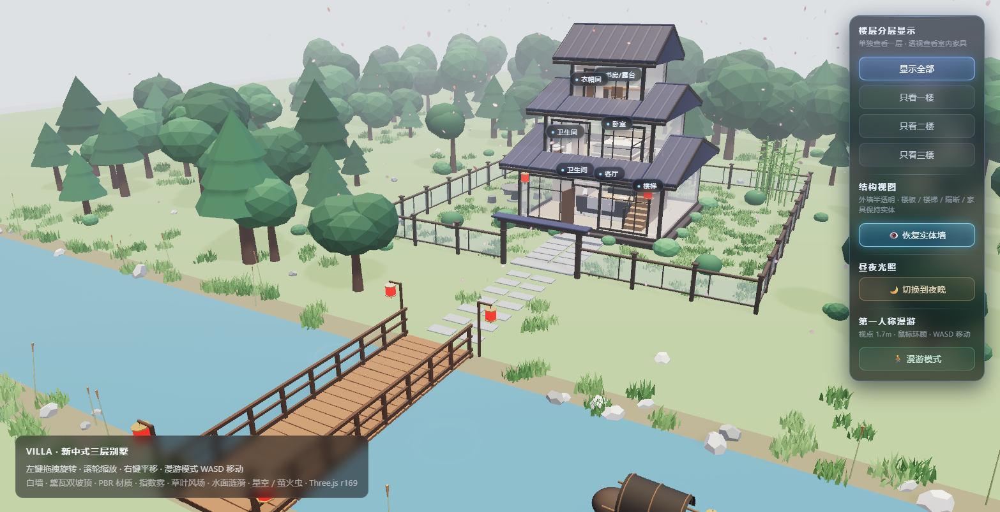

### V10.0 一楼剖切 · 俯视室内布局

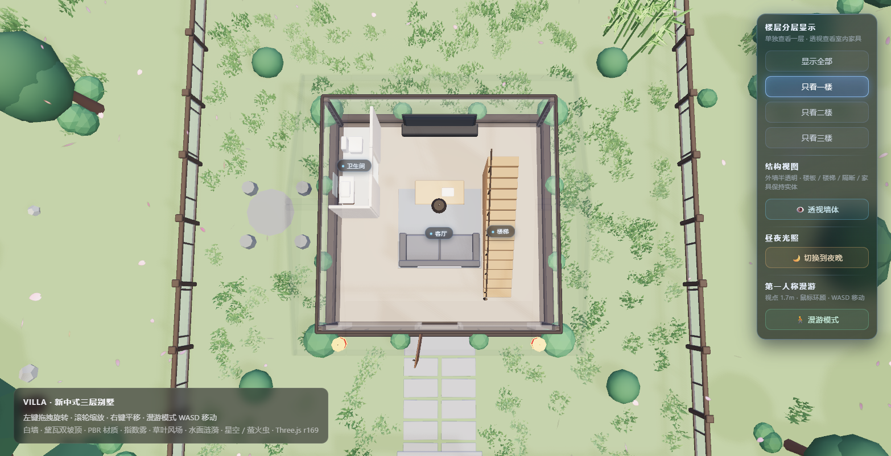

### V10.0 二楼剖切 · 楼板留洞与卧室

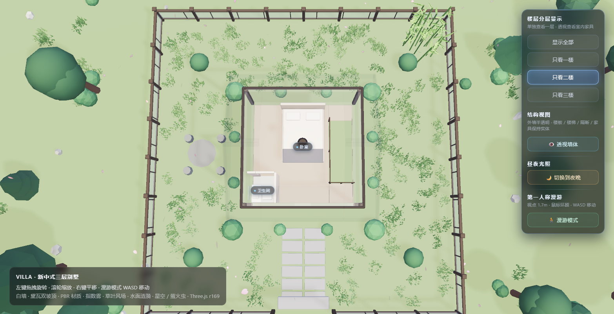

### V10.0 室内漫游 · 客厅 / 楼梯

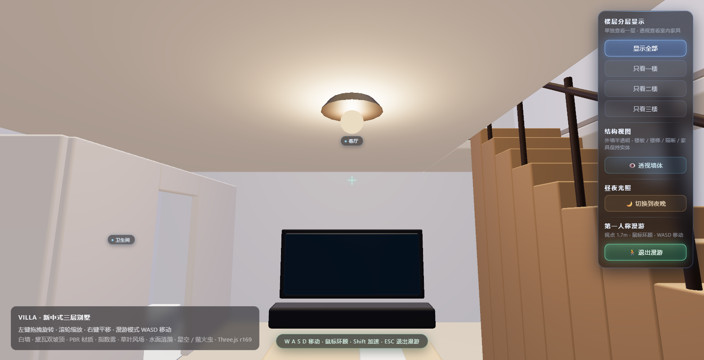

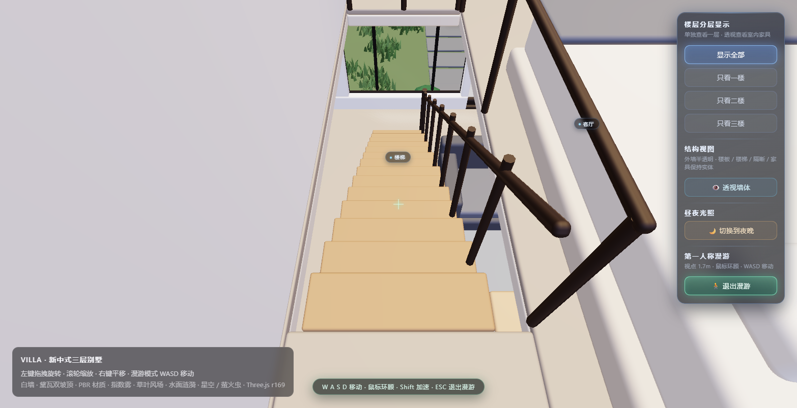

### V9.0 PBR 日景 · 指数雾 / 草叶风场 / 水面细节


### V9.0 夜景 · 星空闪烁 / 暖窗 / 萤火虫微光

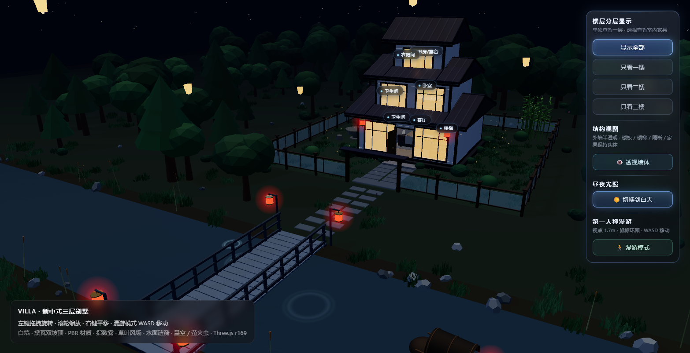

### V8.0 日景 · 森林 / 草簇 / 河流（历史）

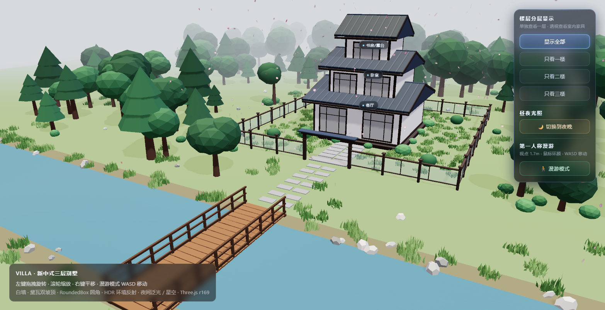

### V8.0 庭院近景 · 草簇与标签气泡（历史）

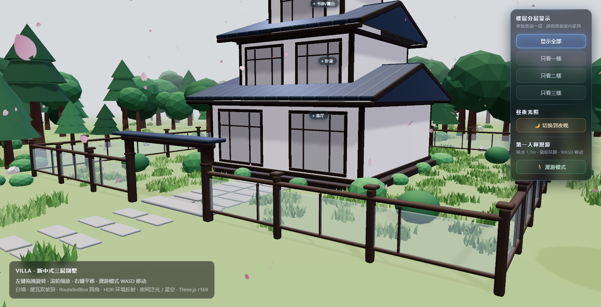

### V8.0 高位广角 · 外围森林密度（历史）

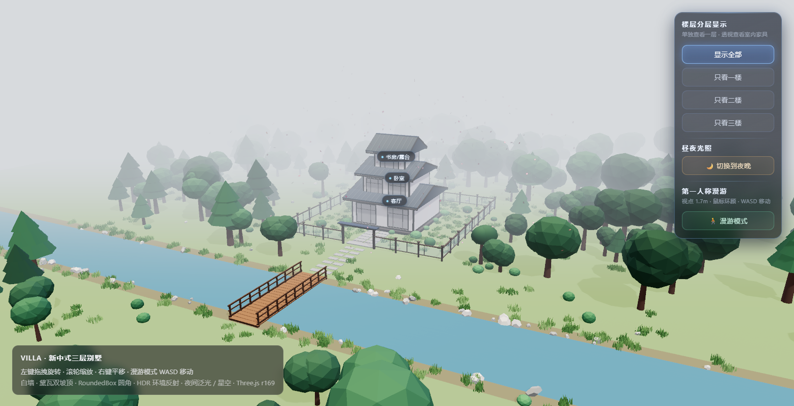

### V8.0 夜景 · 无水面光球 / 暖窗泛光（历史）

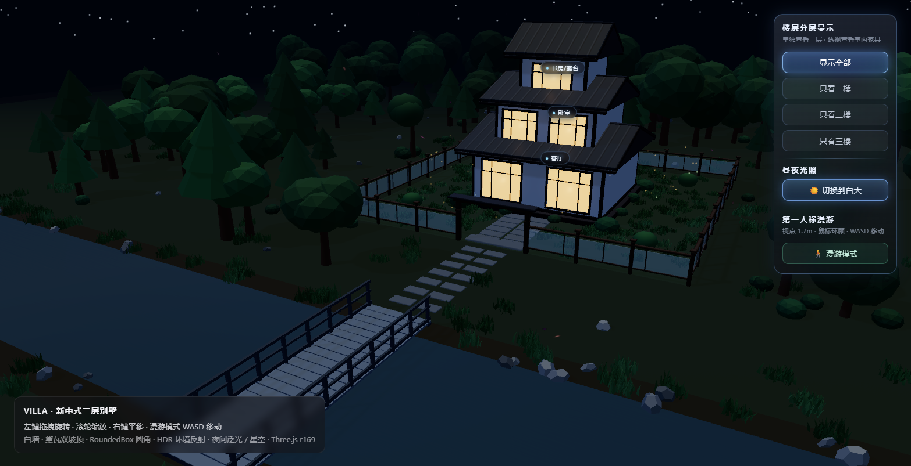

### V7.1 PBR 日景 · 草地 / 河流 / 木桥

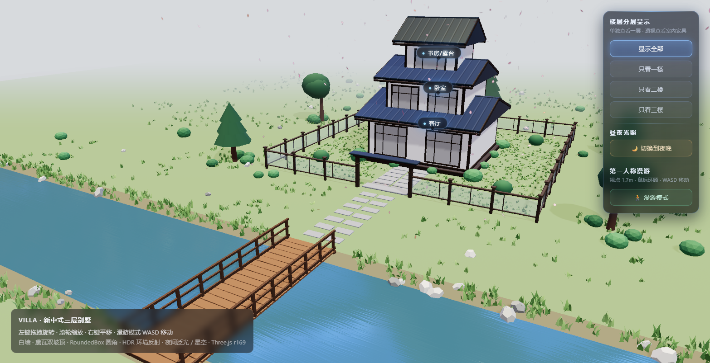

### V7.1 PBR 夜景 · ACES + 泛光

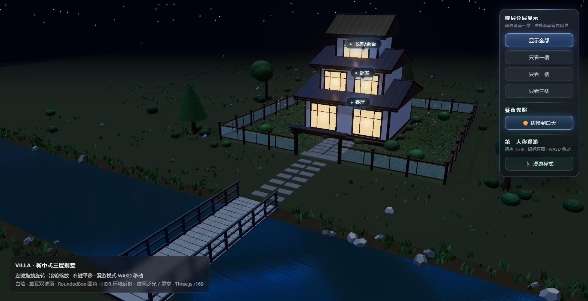

### 第一人称漫游（verify-roam 出图）

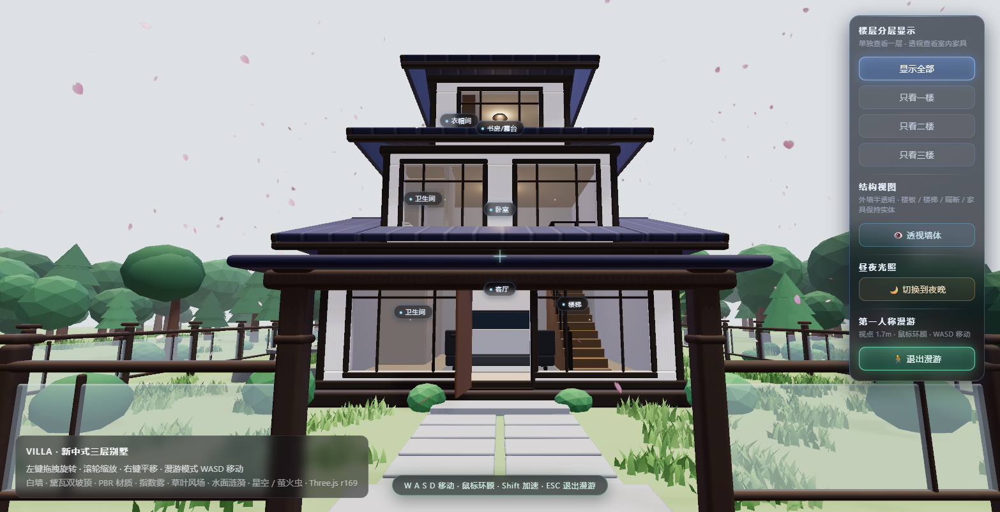

### 庭院日景（verify-courtyard 出图）

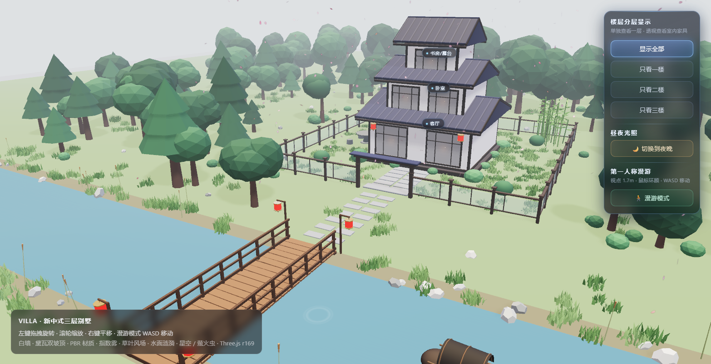

### 庭院夜景 · 泛光 / 萤火虫 / 星空

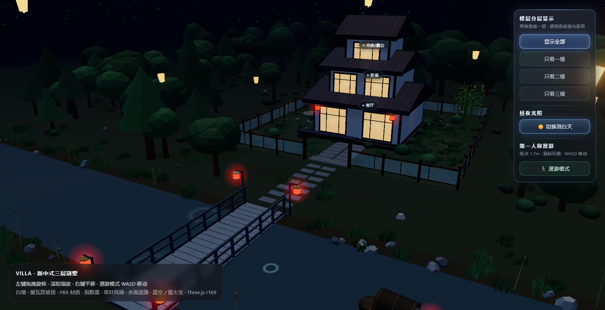

### 夜间一楼剖切

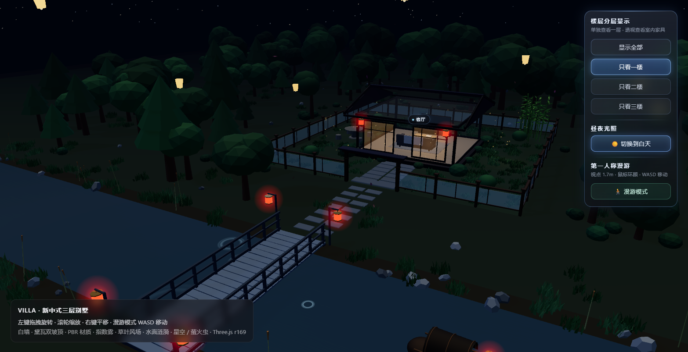

### 日间全景


### 一楼客厅剖切

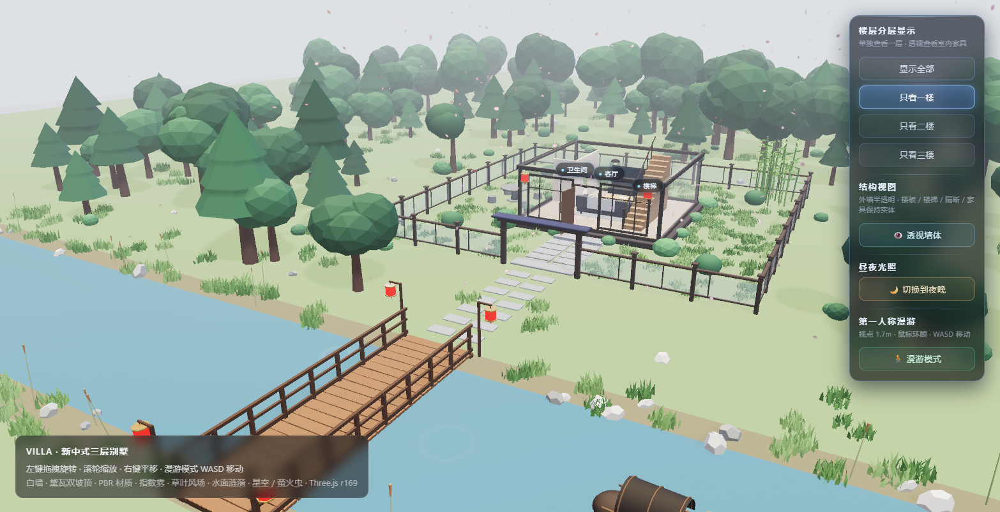

### 二楼卧室剖切

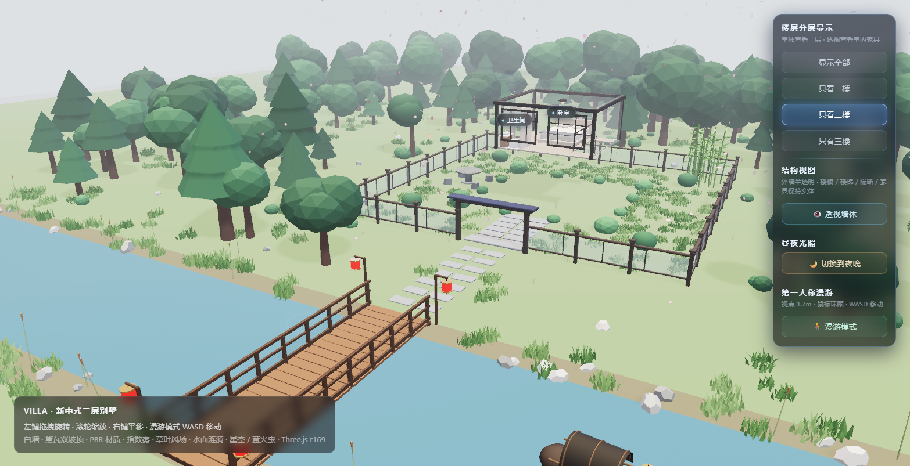

### 三楼书房/露台剖切


### 夜间全景

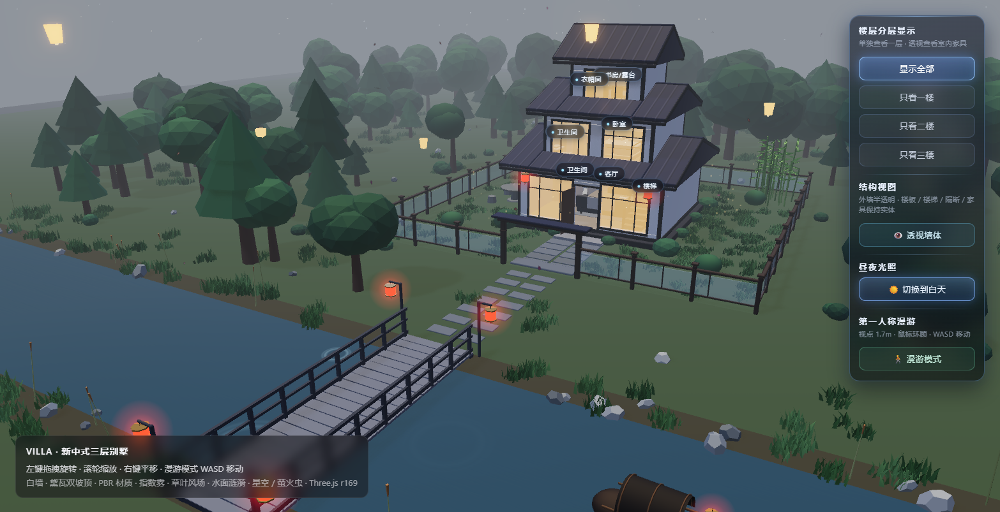

### 夜间一楼剖切

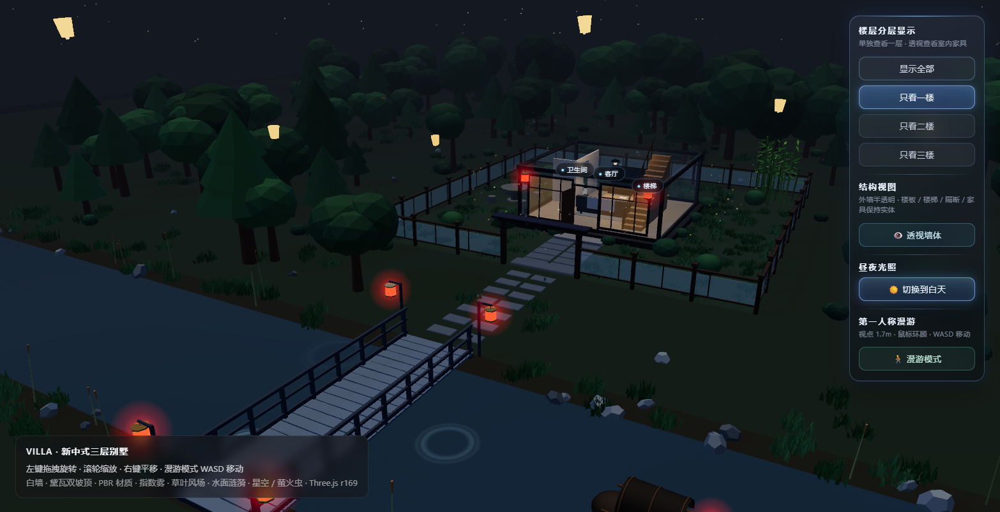

## 文件

- `villa.html`：完整场景（HTML + CSS + ES Module）
- `_ui-check.mjs`：V10.0 UI 交互验证脚本（透视开关 / 单层剖切 / 屋顶淡出 / 标签与灯光隔离 / 进门与上楼 / 控制台错误）
- `_extract.cjs`：把 `villa.html` 里的模块脚本抽成临时文件，配合 `node --check` 做语法体检
- `verify-courtyard.mjs`：庭院 / 昼夜粒子 / Bloom / 室内灯 / 楼层联动自动化验证脚本
- `verify-roam.mjs`：第一人称漫游自动化验证脚本（指针锁定 / WASD / 碰撞 / 退出还原）
- `verify-pbr.mjs`：V9.0 自动化验证脚本（HDR / ACES / 指数雾 / PBR 材质 / 草地风场 / 水面涟漪 / 星空闪烁 / 萤火虫点光 / GLTFLoader / 实例化 / 森林）
- `verify-daynight.mjs`：昼夜过渡自动化验证与出图脚本（`preview-day.png` / `preview-night.png` / `preview-day-again.png`）
- `inspect-v8.mjs`：V8.0 视觉检查与出图脚本（日景 / 庭院近景 / 森林广角 / 夜景）
- `inspect-framing.mjs`：默认机位取景辅助脚本（批量出图对比相机位置）
- `preview-v7-xray.png`：结构透视（`_ui-check.mjs` 出图）
- `preview-v7-floor1-top.png`、`preview-v7-floor2-top.png`：单层剖切俯视，可见楼梯洞口与楼板分块
- `preview-v7-interior.png`、`preview-v7-stairwell.png`、`preview-v7-upstairs.png`：室内漫游视角
- `preview-v9-pbr-day.png`、`preview-v9-pbr-night.png`：V9.0 当前验证脚本出图
- `preview-v8-day.png`、`preview-v8-night.png`：V8.0 日夜截图（历史）
- `preview-v8-garden.png`、`preview-v8-forest.png`：V8.0 草簇近景 / 森林广角（历史）
- `preview-v8-pbr-day.png`、`preview-v8-pbr-night.png`：V8.0 验证脚本出图（历史）
- `preview-v7-pbr-day.png`、`preview-v7-pbr-night.png`：V7.1 PBR 日夜截图（历史）
- `preview-v6-courtyard-day.png`、`preview-v6-courtyard-night.png`：`verify-courtyard.mjs` 当前场景出图（沿用历史文件名）
- `preview-v6-courtyard-night-floor1.png`：夜间一楼剖切（`verify-courtyard.mjs` 出图）
- `preview-v6-roam.png`：第一人称漫游视角（`verify-roam.mjs` 出图）

## 验证

使用 Edge 无头模式 + Chrome DevTools Protocol 自动化验证：

- 三个楼层的标签与楼层分组同步显示 / 隐藏
- 单层查看时墙体透明度、屋顶透明材质、室内补光强度均正确切换
- 昼夜切换后 `nightMix = 1`，夜间剖切补光强度提升到 6.5
- 庭院：119 个围栏构件、5 棵 Low-Poly 树、12 块石板、260 片花瓣、60 只萤火虫、1100 颗星点（其中 2 盏萤火虫跟随点光）
- 草地 / 灌木 / 石头 / 木桥均为 InstancedMesh；新增元素随昼夜一起变色
- 夜间 Bloom 强度 0.32 / radius 0.36 / threshold 0.78，白天自动跳过 Bloom Pass；一楼 / 二楼室内暖光 1.5
- 白天显示樱花，夜晚花瓣淡出并显示萤火虫与星空；单层查看时庭院保持可见
- `node verify-courtyard.mjs`：21 项检查全部通过，控制台错误数：0

### V9.0 PBR / 指数雾 / 动态细节

`node verify-pbr.mjs`（Edge 无头 + CDP，需先在 127.0.0.1:8011 启动静态服务器）：

- `scene.environment` 为 PMREM / CubeUV 贴图，白天强度 0.55、夜晚 0.12
- `ACESFilmicToneMapping`（4），曝光 1.2 / 1.12，`OutputPass` 保持在链路末端（共 3 个 Pass）
- 阴影为 `PCFShadowMap`（type 1），`shadow.radius 4` 生效
- 墙体与石板路几何体均为 `RoundedBoxGeometry`，半径 0.05、2 段细分，80+ 个几何体缓存
- 墙体 `roughness 0.9`；屋檐 0.58 / 0.3 / env 0.75；窗玻璃 0.1 / 0.8 / env 0.5 / opacity 0.6；围栏玻璃 0.32 / 0.02 / env 0.4
- 雾类型为 `FogExp2`，白天密度 0.0075、夜晚 0.015
- 水面 roughness 0.68 / metalness 0 / env 0.35，夜间自发光 0.35；草坪 `bumpMap` 与 `bumpScale 0.06` 生效
- 水面 `bumpScale` 在 0.2 附近呼吸、透明度在 0.94 附近呼吸；9 张涟漪贴片持续扩散；草叶风场 shader 时间持续推进
- 星空 1100 颗 / `size 1.7` / 夜间可见且不透明 / 顶点色存在蓝黄差异；夜间 2 盏萤火虫点光强度合计 > 0.2
- 草地 4800 个实例（10 个一簇）/ 外围森林 200 棵（200 树干 + 600 个树冠实例）/ 灌木 60 丛 / 石头 80 块 / 飘落花瓣 50 片
- 木桥 22 块桥面 + 28 个框架构件；白天 Bloom 关闭，夜间 0.32 / radius 0.36 / threshold 0.78
- 整帧 draw call 约 894（日）/ 915（夜，含 9 张涟漪与点光）；空腔外墙与屋面分件后比 V9.0 增加约 300，脚本上限守到 1200
- `loadModel` 成功加载官方示例 GLB，模型挂到 `externalModels` 且网格数 > 0
- **43 项检查全部通过**，控制台错误数：0

`node verify-daynight.mjs`（同样使用 Edge 无头 + CDP）：

- 夜晚过渡到 `nightMix = 1`，雾密度 0.015，星空可见且不透明，萤火虫可见
- 2 盏萤火虫点光已点亮，9 张水面涟漪在运行，草叶风场时间持续推进
- 切回白天后 `nightMix = 0`，雾密度 0.0075，星空自动隐藏，曝光回到 1.2
- **12 项检查全部通过**，控制台错误数：0

`node inspect-v8.mjs` 仍可生成 V8 历史视角四张图，并输出森林 / 草地 / 水面 / Bloom 状态与 draw call。

### 第一人称漫游

`node verify-roam.mjs`（同样使用 Edge 无头 + CDP，需先在 127.0.0.1:8011 启动静态服务器）：

- 点击按钮后指针锁定成功，OrbitControls 关闭、PointerLockControls 启用，准星与提示出现
- 初始视点 1.7m，位于院门外石径，FOV 从 42° 切到 62°
- W 键可穿过门头走进庭院，高度始终锁定 1.7m；松开按键后速度归零
- 沿石径走上入户台阶、穿过半开的入户门进入一楼客厅（脚下 0.34m，视点 2.04m）
- 客厅东侧的楼梯可以一级级走上二楼（脚下 3.14m，视点 4.84m），楼梯井洞口不挡路
- 横向移动被庭院边界挡住（x ≈ 8.10，测点取 z = 4.5，避开外墙 pad 与四角灌木），不会穿墙
- 从引桥可沿桥面一直走到对岸（z ≈ 25.8）；桥面中段横向被栏杆限制在 x ≈ 0.88，不会掉进河里
- 退出后恢复上帝视角、42° 视野、按钮文案、相机位置与按键状态
- 29 项检查全部通过，控制台错误数：0

`node _ui-check.mjs`（UI 交互 + 剖切 + 透视，同样需要 8011 端口）：

- 初始外墙 `opacity 1 / transparent false`，26 块墙板全部投影
- 透视开启后 `opacity 0.18 / depthWrite false`，墙板不再投影，按钮 `aria-pressed = true` 且文案切到“恢复实体墙”；关闭后逐项还原
- 只看二楼：仅 `group_floor2` 可见，二楼顶板隐藏、楼层标签 `display: none`、其余两层室内补光归零
- 只看二楼：二楼自身的 16 件屋面构件全部半透明；切回“显示全部”后三层 43 件全部恢复实体
- 漫游按下 W 能从门口走进客厅（feetY 0.34），沿楼梯上到二楼（feetY 3.14）
- **14 项检查全部通过**，控制台错误数：0

## 第三方资源与致谢

| 资源 | 来源 | 许可 |
| --- | --- | --- |
| Three.js r169 及 addons | <https://github.com/mrdoob/three.js> | MIT |
| `royal_esplanade_1k.hdr` 环境贴图 | Three.js 官方示例资源（原始素材由 Poly Haven 提供） | CC0 |
| 其余全部纹理 | 本项目 Canvas 2D 程序化生成 | 同本仓库许可 |

HDR 地址在 `villa.html` 的 `ENV_HDR_URL` 里，换成自己的素材只需改这一行；商用前请再次确认所替换素材的许可。

## 贡献

- 保持 `villa.html` 单文件、无构建依赖
- 新增可调参数放进顶部 `CONFIG`，不要在业务代码里散落魔法数字
- 会改变渲染结果的改动，请跑对应验证脚本（见「验证」）并附上出图
- 提交信息建议用 `feat:` / `fix:` / `perf:` / `docs:` 前缀

## 许可证

本项目采用 **MIT** 许可证，详见 [LICENSE](LICENSE)。

第三方依赖与素材各自沿用其原始许可，见上方「第三方资源与致谢」。
